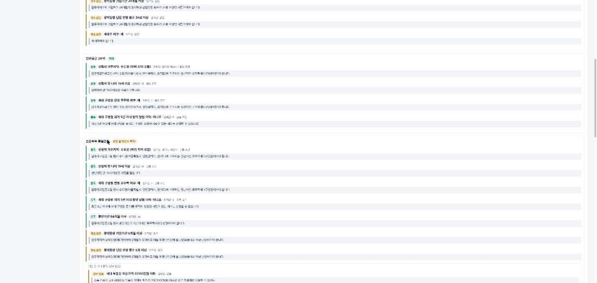

# cheongyak-verifier · 청약 자격 판정기

아파트 **입주자모집공고문**을 넣으면 다음 순서로 자격을 판정하는 로컬 웹 앱 + CLI입니다.

1. LLM이 공급유형별 신청 자격 조건을 **공고 원문 인용과 함께** 추출해요.
2. 사람이 조건을 검토·승인해요.
3. **Wirelog(PyreWire) 규칙**이 신청자 정보로 공급유형별 자격을 **결정적으로 판정**해요.

모든 판정에는 "어떤 조건을, 공고의 어느 문장 때문에, 신청자의 어떤 값으로" 충족·미충족했는지가 함께 표시됩니다.



> ⚠️ 이 도구는 공고 이해를 돕는 보조 도구입니다. 청약홈의 공식 자격 확인과 법령 해석을 대신하지 않습니다.

## 왜 만들었나

청약 공고는 공급유형(신혼부부·생애최초·다자녀·일반 1·2순위 등)마다 무주택·통장·소득·자산·거주 요건이 다르고 수십 쪽에 흩어져 있습니다.
LLM에게 "나 신청 가능해?"라고 바로 물으면 그럴듯하지만 근거를 확인하기 어려운 답이 나옵니다.

이 프로젝트는 역할을 나눕니다.

| 단계 | 담당 | 결정성 |
| --- | --- | --- |
| 공고문 → 조건 후보 | LLM (Claude Code, Codex, Cursor, Copilot, Antigravity CLI) | 비결정적 → **검증·검토로 통제** |
| 조건 후보 → 승인 조건 | 사람 | 검토 이력 보존 |
| 승인 조건 + 신청자 정보 → 판정 | Wirelog 규칙 (`cheongyak/rules.dl`) | **결정적** (같은 입력 → 같은 결과) |

## 핵심 설계

### 1. 고정 어휘 안에서만 추출

LLM은 `cheongyak/vocab.py`에 정의된 공급유형·속성·연산자·지역만 쓸 수 있습니다.

- 속성 예: `age`, `homeless_household`, `account_months`, `deposit_count`, `income_pct`, `assets`, `marriage_months`, `minor_children`, `residence` 등 18개
- 연산자: 정수 `ge/gt/le/lt/eq/ne`, 예/아니오 `eq/ne`, 지역 `in`

어휘로 표현할 수 없는 요건(예외 규정, "다만 ~인 경우" 등)은 조건으로 억지로 만들지 않고 **직접 확인할 요건(notes)**으로 따로 남깁니다.

### 2. 원문 인용 검증

모든 조건·공급유형·notes는 공고 원문에 **그대로 있는 연속 구간**을 인용해야 합니다.
공백·줄바꿈 차이만 허용하고 의역은 거부합니다.
어휘 밖의 값이나 원문에 없는 인용은 저장하지 않고, 실행 기록에 **버린 이유**를 남깁니다(조용히 고치지 않음).

### 3. 사람 검토

추출된 조건은 모두 **검토 대기**로 저장됩니다.

- 승인된 조건만 판정에 쓰입니다.
- 수정하면 새 리비전이 되어 다시 검토해야 합니다.
- 오래된 리비전을 승인하려 하면 거부합니다(낙관적 동시성).
- 검토자·사유·시각이 이력으로 남습니다.

### 4. Wirelog 판정 규칙

`cheongyak/rules.dl`의 Datalog 규칙이 판정을 전부 계산합니다. Python은 사실을 넣고 결과를 읽을 뿐입니다.

```prolog
// 지역 계층: 하위 지역은 모든 상위 지역에 포함 (재귀)
within(X, Y) :- region_parent(X, Y).
within(X, Z) :- region_parent(X, Y), within(Y, Z).

// 조건 단위: 정보가 없으면 실패가 아니라 미확인
pass(C) :- cond(C, _, _, A, "ge", V), applicant(A, X), X >= V.
fail(C) :- known(C), !pass(C).
unknown(C) :- cond(C, _, _, _, _, _), !known(C).

// 같은 그룹 = OR, 다른 그룹 = AND
group_fail(S, G) :- group(S, G), !group_pass(S, G), !group_open(S, G).
eligible(S) :- has_cond(S), !supply_fail(S), !supply_open(S).
```

판정은 세 갈래입니다.

- **적격**: 모든 조건 그룹을 충족해요.
- **부적격**: 하나라도 확실히 미충족이에요.
- **판정 불가**: 미충족은 없지만 정보가 부족해요.

정보가 없다고 부적격으로 처리하지 않는 것이 핵심입니다.

- **공통 조건**: `supply = "all"`인 조건은 모든 공급유형에 자동으로 들어갑니다.
- **지역 조건**: `경기도 하남시 ⊂ 경기도 ⊂ 수도권`처럼 계층을 따라 판정합니다.
- **재현 정보**: 결과에 엔진 버전, 규칙·조건·신청자 정보의 SHA-256을 남겨 같은 판정을 재현할 수 있습니다.

## 설치

Python 3.11 이상이 필요합니다. 추출에는 에이전트 CLI 중 하나의 설치·로그인이 필요합니다(Claude Code 권장).

```sh
git clone https://github.com/theco2de/cheongyak-verifier.git
cd cheongyak-verifier
python3 -m venv .venv
source .venv/bin/activate
pip install -e .
```

## 사용법

### 웹 앱

```sh
cheongyak serve            # http://localhost:8770
```

1. **공고 등록**: TXT/MD/PDF 파일을 고르거나 텍스트를 붙여 넣습니다.
2. **조건 검토 → 추출 시작**: 에이전트와 모델을 골라 조건 후보를 추출합니다.
3. **조건 검토**: 각 조건의 공고 인용을 확인하고 승인·반려·수정합니다(일괄 승인 가능).
4. **자격 판정**: 아는 항목만 입력하고 판정합니다. 이전 판정 기록도 다시 볼 수 있습니다.

서버는 `127.0.0.1`에만 바인딩하고 Host/Origin 검사를 합니다. 원문과 모델 출력은 HTML로 실행하지 않습니다.

### CLI

```sh
cheongyak add examples/sample_notice.md --title "가온숲 시범단지(가상)"
cheongyak extract <notice-id> --agent claude          # 또는 codex, cursor, copilot, agy
cheongyak conditions <notice-id>
cheongyak review <notice-id> --all-pending --reviewer 홍길동 --reason "원문 대조"
cheongyak judge <notice-id> --profile examples/profile_newlywed.json
```

LLM 없이 시연하려면 실제 Claude 추출 결과를 저장해 둔 픽스처를 가져올 수 있습니다.

```sh
cheongyak import <notice-id> tests/fixtures/claude_sample_response.json
```

출력 예시(가상 공고, 소득 150%·자산 2.1억·자녀 1명인 신혼부부):

```
■ 신혼부부 특별공급: 적격
  ✔ 혼인기간 84개월 이하  (신청자: 36)
     └ 공고: "입주자모집공고일 현재 혼인기간이 7년 이내인 무주택세대구성원이어야 합니다."
  ✔ 다음 중 하나 [i-g8]
    ✔ 세대 부동산 자산가액 33100만원 이하  (신청자: 21000)
       └ 공고: "소득 기준을 초과하더라도 부동산 가액의 합계가 3억 3,100만원 이하인 경우 추첨제로 신청할 수 있으나"
    ✘ 전년도 도시근로자 가구원수별 월평균소득 대비 가구 소득 비율 140% 이하  (신청자: 150)
       └ 공고: "세대의 월평균소득이 전년도 도시근로자 가구원수별 월평균소득의 140% 이하여야 합니다."
  ✔ 세대 부동산 자산가액 33100만원 이하  (신청자: 21000)
     └ 공고: "세대 구성원 전원이 소유한 부동산 가액의 합계가 3억 3,100만원 이하여야 합니다."
...
■ 생애최초 특별공급: 부적격
  ✘ 전년도 도시근로자 가구원수별 월평균소득 대비 가구 소득 비율 130% 이하  (신청자: 150)
     └ 공고: "세대의 월평균소득이 전년도 도시근로자 가구원수별 월평균소득의 130% 이하여야 합니다."

※ 규칙으로 표현하지 못해 직접 확인할 요건
  - 해외 체류 기간이 연속 90일을 초과하면 해당 지역 거주자로 보지 않음 ...
```

## 실제 추출 사례

`examples/sample_notice.md`(가상 공고)를 Claude Code CLI로 추출한 결과는 아래와 같습니다. 원본은 `tests/fixtures/claude_sample_response.json`에 있습니다.

- **소요**: 1회 호출, 약 52초, CLI 보고 비용 약 $0.16
- **조건**: 21개 추출, 검증 탈락 0개
- **공급유형**: 5개 인식
- **직접 확인할 요건**: 5개를 notes로 분리
- **잘 처리한 점**: 신혼부부의 "소득 초과 시 자산 기준 충족하면 추첨제" 예외를 `(소득 ≤ 140% OR 자산 ≤ 3.31억)` OR 그룹과 별도 `자산 ≤ 3.31억` AND 조건으로 표현했습니다. 공고 의미와 논리적으로 같습니다.
- **분리한 요건**: "해외 체류 90일 초과 시 거주자 불인정" 같은 예외 규정은 조건으로 만들지 않고 notes로 분리했습니다.

이처럼 LLM의 구조화 결과는 대체로 좋지만, OR/AND 묶음은 판정 결과를 직접 바꾸므로 **사람이 원문과 대조해 승인**하도록 설계했습니다.

## 한계

- **표현 범위**: 조건은 "그룹 내 OR, 그룹 간 AND"의 한 단계 구조만 표현합니다. "(A 그리고 B) 또는 C" 같은 중첩 조건은 notes로 남기거나 수동으로 분해해야 합니다.
- **점수 계산 미지원**: 가점제 점수 계산, 소득 기준표(가구원수별 금액) 자동 환산, 당첨자 선정 순위는 다루지 않습니다.
- **입력 형식**: 스캔 PDF(OCR)는 지원하지 않습니다.
- **판정의 근거**: 정확한 인용이 있다고 해서 의미 해석이 맞다는 보장은 없습니다. 최종 책임은 검토자에게 있습니다.
- **사용 범위**: 단일 사용자 로컬 앱입니다. 인증·다중 사용자·암호화를 제공하지 않습니다.

## 프로젝트 구조

```
cheongyak/
  vocab.py        고정 어휘(공급유형·속성·연산자) + 지역 계층 로더
  regions.json    전국 → 수도권/비수도권 → 시도 → 시군구(서울·경기·인천)
  extract.py      프롬프트, 구간 분할, 어휘·인용 검증
  agents.py       5개 에이전트 CLI 어댑터(shell 미사용), 테스트용 FixtureTransport
  rules.dl        Wirelog 판정 규칙
  engine.py       PyreWire 실행 + 조건별 근거 조립
  store.py        SQLite: 공고·조건 리비전·검토 이력·실행·판정 스냅샷
  service.py      웹/CLI 공통 작업 흐름
  server.py       로컬 HTTP 서버(표준 라이브러리)
  cli.py          명령줄 인터페이스
  web/            바닐라 JS 화면
examples/         가상 공고문, 신청자 예시
tests/            엔진·추출 검증·작업 흐름·HTTP 테스트(실제 PyreWire 사용)
```

## 테스트

```sh
python -m unittest discover -s tests -v
```

테스트는 실제 PyreWire 엔진으로 다음을 확인합니다.

- 경계값 비교, OR/AND 그룹, 정보 부족 시 판정 불가, 지역 계층 전이
- 입력 순서와 무관한 결정성
- 인용·어휘 검증과 리비전 동시성
- 미승인 조건 제외, 실패 시 무저장
- HTTP Origin 검사

## 참고한 오픈소스

- [PyreWire](https://pypi.org/project/pyrewire/) / Wirelog: Datalog 규칙 엔진
- [pypdf](https://pypi.org/project/pypdf/): PDF 텍스트 추출
- 에이전트 CLI: Claude Code, OpenAI Codex, Cursor, GitHub Copilot CLI, Antigravity
- 오픈소스 AI 멘토링 과정에서 강사님이 예시로 보여 준 `verinote`(근거 기반 위키 + Wirelog 조회)와 `agent-workflows`(Wirelog 기반 스킬 선택 하네스)의 "LLM이 추출하고 Wirelog가 검증한다"는 구조를 참고했습니다. 코드는 이 프로젝트에서 새로 작성했습니다.

## 라이선스

[Apache License 2.0](LICENSE)
